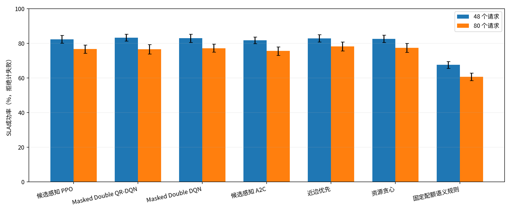

# 面向低空智联的多模态网络切片技术

本报告仅包含第一部分“智能分配”。题目、研究点和遥测、命令、地图业务名称保留。

验证集在4种RL中选定 **Masked Double DQN**。主测试3初始化平均SLA成功率 **79.38%**；预先指定的主对照 **资源贪心** 为 **79.35%**。
配对差值 **+0.03个百分点**，95%区间 **[-1.07, +1.08]个百分点**。本轮区间包含零，尚不能确认所选RL优于Greedy。

## 环境与方法

12架无人机、双AP、双互连边缘，4移动/8驻留，高80m，速度5/8/11m/s。遥测上行IP；命令下行IP/受限EID-RLOC；地图IP/原生NDN。17维资源账本，功能配置在ns-3/ndnSIM/NFD实际执行。
LogDistance指数2.5叠加120m有限覆盖，发射20dBm、固定24Mbps；保留硬覆盖边界，不声称一般低空信道。回源1Mbps、跨边缘0.5Mbps、接入2Mbps均为研究配置。预约是准入模型，不是逐包QoS证明。
PPO、QR-DQN、标量Double-DQN、A2C各3初始化、每模型32768次决策，检查点仅由验证选择；随后对所选算法重训3类消融、每类3初始化，总21个模型、688128次训练决策。无集成、专家先验或规则兜底。四种方法使用相同环境、观测和可行性掩码；学习配方与更新次数不同，属于等交互预算选型，不是只替换学习目标的消融。
训练41000000—41999999；验证42000—42007；新主测试53000—53029；移动受控54000—54009。Greedy和主表基线在新测试前指定；价格、语义规则保留补充比较。规则阈值仅在验证集选择，正式测试后未调参。单模型执行入口预先指定初始化11，性能统计始终包含全部3个初始化。

## 主测试

| 方法 | SLA成功率 | 95%区间 | 接纳率 | 已接纳违约率 |
|---|---:|---:|---:|---:|
| 候选感知 PPO | 78.79% | [77.00%, 80.68%] | 85.87% | 8.24% |
| Masked Double QR-DQN | 79.10% | [77.19%, 81.04%] | 86.17% | 8.21% |
| Masked Double DQN | 79.38% | [77.51%, 81.11%] | 87.60% | 9.39% |
| 候选感知 A2C | 77.93% | [76.20%, 79.61%] | 86.05% | 9.43% |
| 首次可行 | 77.94% | [76.15%, 79.71%] | 88.54% | 11.97% |
| 近边优先 | 80.03% | [78.10%, 81.93%] | 90.31% | 11.39% |
| 资源贪心 | 79.35% | [77.40%, 81.22%] | 89.95% | 11.78% |
| 固定配额语义规则 | 63.31% | [61.77%, 64.95%] | 67.24% | 5.85% |

总体值对48/80两负载按请求数合并；同一场景下所有方法使用相同业务与无线种子。区间同时重采样初始化及场景；仅3个初始化，训练稳定性估计仍有限。规则区间仅重采样场景。

## 补充强规则对比

| 方法 | SLA成功率 |
|---|---:|
| 资源价格规则 | 79.77% |
| 业务语义与移动规则 | 79.56% |

验证集选定的参考规则为资源价格规则；所选RL相对该规则差值-0.39个百分点，95%区间[-1.45, +0.68]。此比较完整保留，不以主表基线的强弱代替方法有效性判断。

## 全部初始化与业务分组

| 初始化 | 所选RL的SLA成功率 |
|---|---:|
| 11 | 78.44% |
| 23 | 79.90% |
| 37 | 79.79% |

初始化样本标准差：0.81个百分点。

| 业务 | 所选RL | Greedy |
|---|---:|---:|
| 遥测 | 64.31% | 66.72% |
| 命令 | 87.86% | 88.44% |
| 地图 | 87.00% | 84.47% |

## 同配方重训消融

| 对照 | 完整方法−对照（百分点） | 配对95%区间 |
|---|---:|---:|
| 固定模态 | +2.20 | [-0.16, +4.58] |
| 去掉显式端点移动观测 | +1.31 | [+0.05, +2.64] |
| 去掉未来预约日历 | -0.37 | [-1.48, +0.87] |

共享资源实验：相同语义与移动规则族、各自在验证集选择阈值，采用共享池相对固定配额差值为+16.25个百分点，区间[+14.82, +17.71]。这个差值不归因于RL，也不是固定完全相同阈值的单变量消融。
移动消融移除当前请求及全体端点的直接位置、角色、关联和速度编码；掩码仍执行必要可行性检查，活跃合同的业务/模态汇总及其中巡检比例保留，因此它不是消除全部移动相关信息的消融。去掉日历只移除未来1/3/6秒的预约向量，保留当前预约和已签合同的其他汇总。消融区间属于探索性分析，未作多重比较校正。

## 移动受控实验

| 方法 | 全部驻留 | 单AP内移动 | 原跨AP巡检 |
|---|---:|---:|---:|
| Masked Double DQN | 85.25% | 85.29% | 75.79% |
| 资源贪心 | 88.00% | 88.62% | 74.88% |
| 业务语义与移动规则 | 83.75% | 83.75% | 76.12% |
| 资源价格规则 | 89.50% | 90.00% | 75.88% |

单AP内移动将巡检航线限制为x=30—45m；驻留保留各节点初始位置。移动与驻留改变后续几何位置及关联，不能将差值解释为仅有协议切换中断这一因素。受控实验每条件10个独立种子，只用于敏感性评测。

## 资源压力敏感性

补充实验在正式主测试前单独预注册：回源受限为80个平衡请求、回源0.45Mbps；空口压力为160个请求、每请求以0.85概率强制为遥测（其余保留），所有有线速率提高8倍。均使用55000—55009种子，不改变主场景，也不把容量变化当作算法收益。

| 方法 | 回源受限 | 空口压力 |
|---|---:|---:|
| Masked Double DQN | 64.75% | 70.88% |
| 资源贪心 | 65.12% | 70.88% |
| 业务语义与移动规则 | 66.00% | 72.56% |
| 资源价格规则 | 65.50% | 70.69% |

开发诊断覆盖32/48/64/80/96请求，主配置的不可行候选主要超出有线方向预约额度，不能据此宣称无线为主瓶颈。12组单请求/位置/传播配置均完成198/198包按时交付；距离损耗在部分位置改变关联路径及时延，本次标定没有证明覆盖内单业务发生显著渐进丢包。因此低空影响仍主要通过几何、竞争和接入变化体现。

## 资源开销与验证

所选RL：每成功合同实际有线字节117145.3B，PHY发射时间0.0258s，容量归一化预约消耗2.2646s，平均决策0.851ms。并行评测存在CPU争用，决策耗时不是独占部署延迟基准。
全部1920个正式回合已独立重读逐包事件重建SLA、检查遥测方向和资源事务；21个所选模型均通过代表场景完整事件CSV精确重放。源码、原生二进制、模型和同场景指纹一致。
测试日志及详细统计见`verification.json`和`analysis.json`；复现命令见`REPRODUCE.md`。

## 结论适用范围

本轮区间包含零，尚不能确认所选RL优于Greedy。 本轮没有实现资源预测、运行期主动迁移、CPU处理模型或确定性带宽/时延保障。IP下行采用准入时定位绑定；不将模态对比推广为对全部IP移动方案的比较。
环境与旧报告不同，旧成功率不能作为本轮改进幅度。协议选择比例本身也不证明选择有效。
